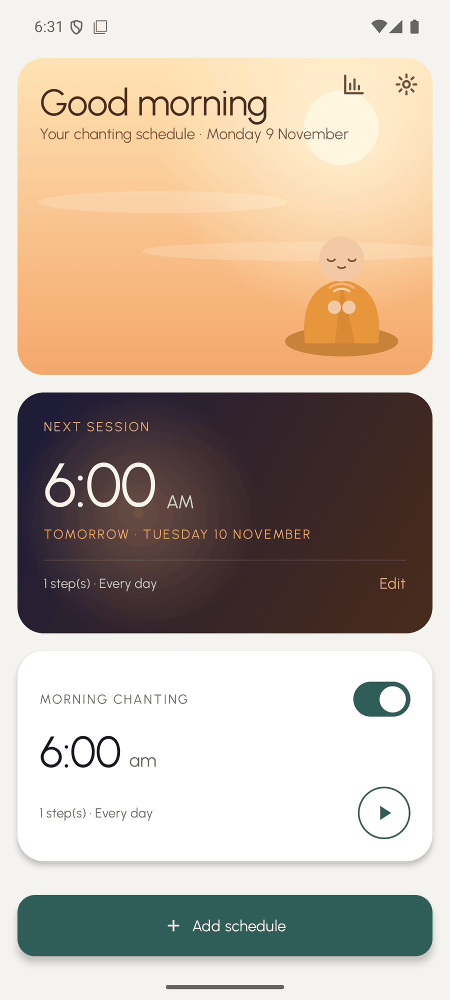
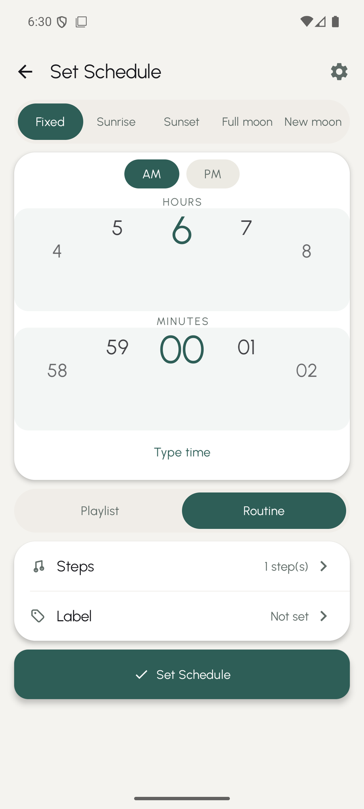
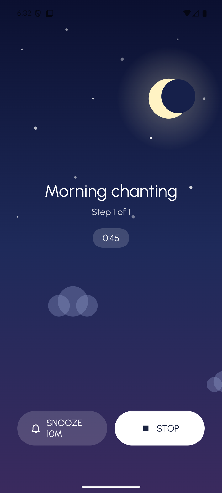
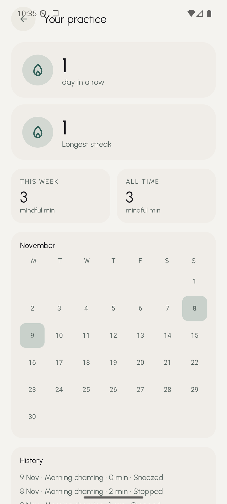

# Chanting Buddy

**Your chants play on time, every day, without opening the app.**

[](https://github.com/invoicebuddies/daily-scheduling-chanting-mobile-app/releases/latest)
[](https://github.com/invoicebuddies/daily-scheduling-chanting-mobile-app/releases/latest)
[](https://github.com/invoicebuddies/daily-scheduling-chanting-mobile-app/actions/workflows/android.yml)

<p align="center">
  
  
  
  
</p>

## Why Chanting Buddy

- **It plays by itself.** Pick a time — a fixed clock time, sunrise, sunset, or the full/new moon — and your chanting sounds start on their own.
- **Works offline.** Only the optional address search needs the internet.
- **No account, no ads, no tracking.** Nothing to sign up for, ever.
- **Free.** If it brings you peace, a tip for a cup of coffee is welcome (see below), but the app is free to use.

## Download & install (no coding needed)

1. Open the **[latest release](https://github.com/invoicebuddies/daily-scheduling-chanting-mobile-app/releases/latest)** and download the APK for your phone:
   | File | Which phone |
   |---|---|
   | `ChantingBuddy-vX.X-arm64-v8a.apk` | Most modern phones — pick this one |
   | `ChantingBuddy-vX.X-armeabi-v7a.apk` | Older 32-bit phones |
   | `ChantingBuddy-vX.X-universal.apk` | Not sure? Use this |
2. Open the downloaded file on your phone.
3. If your phone asks, allow the browser or file manager to *install apps from unknown sources* — that's just Android's wording for installing an app outside the Play Store, and it's safe here because it comes straight from this project.
4. Tap **Install**, then open the app.

The app ships with built-in bell sounds, so it can ring before you've picked any files of your own.

## Quick start (first 2 minutes)

1. Open Chanting Buddy and finish the short introduction (or skip it).
2. When asked, allow **notifications** and **exact alarms** — the app can't chant on time without them.
3. Tap **+ Add schedule**.
4. Pick **Fixed** and set a time, or choose **Sunrise** / **Sunset** (set your location first if asked). Full-moon and new-moon days are there too, if your practice follows them.
5. Check the sound — a built-in bell is already chosen. Add your own audio files if you like.
6. Tap **✓ Set Schedule**. Done.

> **Worth 30 seconds:** open **Settings → Alarms & Reliability** and use the fix buttons for exact alarms, battery optimization, and full-screen alarms. This is the single biggest factor in whether chants fire on time on real phones.

## Features

**Scheduling**
- Fixed time, sunrise, or sunset, each with a ±60-minute offset
- Full-moon and new-moon triggers (useful for Uposatha days)
- Repeat on chosen days of the week
- Optional pre-session reminder, 5 or 10 minutes before
- Alarms survive reboot, app updates, clock and timezone changes
- Snooze for 5, 10, or 15 minutes, from the ringing screen or the notification

**Sound**
- Built-in bell and singing-bowl sounds — works out of the box
- Playlists from your own audio files (SAF picker, keeps working across reboots)
- Gap between tracks, repeat the playlist ×1 to ×108, or auto-stop after 5–60 minutes
- Routines: ordered practice sessions — each sound (or a silence) is held for a set number of minutes, step by step
- Gentle volume fade-in (off, 30 s, 1, 2, or 5 minutes)
- Lock-screen and Bluetooth media controls via the playback notification
- If a file was deleted, the app falls back to a built-in chime and tells you to fix the schedule

**Practice**
- Every session is logged automatically
- Streaks (current and longest), mindful minutes, this week / all time
- Monthly calendar view coloured by practice time
- Recent history list with how each session ended
- Undo delete (5 seconds to change your mind)

**Look & feel**
- Light, dark, or follow-the-system theme
- Calm onboarding you can replay any time
- Home-screen widget with the next session and a play/stop button; Quick Settings tile for "chant now"
- Backup & restore of schedules and history as a JSON file
- English, 简体中文, and Bahasa Melayu
- "Reduce motion" option for calmer screens

## Permissions

| Permission | Why it's needed | Required? |
|---|---|---|
| Notifications | Show the alarm and playback notification | Yes |
| Exact alarms | Fire chants at the precise scheduled time | Yes |
| Run at startup | Re-arm alarms after your phone reboots | Yes |
| Full-screen alerts | Show the ringing page on a locked screen | Recommended |
| Foreground media playback | Keep chanting while the screen is off | Yes |
| Battery optimisation exemption | Keep alarms reliable in the background | Recommended |
| Location (coarse) | Calculate your local sunrise and sunset | No — manual entry or address search also works |
| Internet | Only for the optional address search | No |

The app doesn't collect, send, or sell any personal data. Everything stays on your phone.

## Troubleshooting: "My chant didn't play"

| Symptom | What to do |
|---|---|
| Chants stop after a while on some phones | Xiaomi, Samsung, Huawei, OPPO, vivo and OnePlus aggressively kill background apps. Open **Settings → Alarms & Reliability** and tap the battery fix button, and check [dontkillmyapp.com](https://dontkillmyapp.com) for your model. |
| Alarm fires late or not at all | Exact-alarm permission may have been revoked — the same settings screen has a fix button. |
| You changed or deleted the sound file | Re-pick it in the schedule (Sounds row). Until then the app rings a built-in chime. |
| Sunrise/sunset schedule never fires | No location is set — add one in **Settings → Location** (device, search, or manual coordinates). |
| Chant is silent | Playback follows your **media** volume, so silent mode or Do Not Disturb can mute it — raise media volume or allow the app in DND. |
| You travelled or the clock changed | Nothing to do: the app listens for time and timezone changes and re-arms your alarms automatically. |

## Privacy

Everything — schedules, sounds, history, settings — is stored on your device. There is no analytics, no account, no server. Your location is used only to calculate sun times and never leaves the phone, except when you use the optional address search, which goes through Android's built-in Geocoder.

**Update check:** if you installed the app from the APK here, it checks for a newer release at most once a day. That request goes to GitHub's public API with a generic "ChantingBuddy/&lt;version&gt;" user agent — no account, no device identifier, nothing personal. It can be turned off in **Settings → About**, and "Check for updates now" never sends anything beyond that same anonymous request.

## Support the project

If Chanting Buddy has become part of your daily practice and you'd like to say thanks, you're welcome to buy me a coffee: https://ko-fi.com/xia0da. No pressure at all — the app is free either way.

## For developers

Native Android in **Kotlin + Jetpack Compose**, with Room, Hilt, Media3/ExoPlayer, commons-suncalc, and Glance (see `gradle/libs.versions.toml` for versions). Multi-module: `app`, `core:data`, `core:scheduling`, `core:player`.

Requirements: JDK 17+ and the Android SDK (API 36).

```bash
./gradlew assembleDebug   # debug APKs under app/build/outputs/apk/debug/
./gradlew assembleRelease # release APKs under app/build/outputs/apk/release/,
                          # plus user-facing copies in app/build/outputs/release-named/
./gradlew test            # JVM unit tests (trigger math, moons, routines, migrations, backup codec)
./gradlew lintDebug       # lint, 0 errors expected
```

Release signing uses a gitignored `keystore.properties` — the keystore is intentionally not in the repo.

See [AGENTS.md](AGENTS.md) for architecture, design system, and testing recipes.

## Contributing

Issues and pull requests are welcome. Please run `./gradlew test lintDebug` before opening a PR, and include manual test notes for anything touching alarm or playback reliability.

## License

License: not yet specified. (See [LICENSES.md](LICENSES.md) for third-party asset attribution.)

---

*Android only. Made in Singapore.* 🇸🇬
